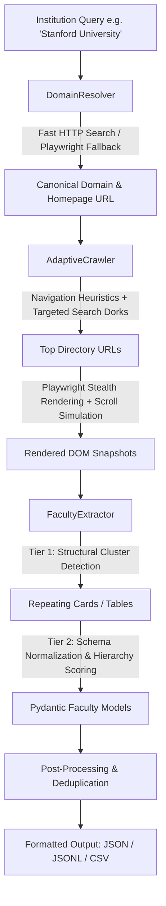

# Autonomous Global Academic Faculty & Leadership Scraper

An enterprise-grade, autonomous web scraping pipeline engineered to extract academic leadership, department heads (HODs), deans, chairs, and distinguished faculty from higher education institutions globally.

---

## 🌟 Key Highlights & Innovations

- **Zero Hardcoded Selectors:** Uses two-tier structural clustering and heuristic DOM card detection to dynamically parse arbitrary university templates across WordPress, Drupal, React, Vue, and custom portals.
- **Global ccTLD Domain Resolution:** Automatically identifies official institutional portals across global country domains (`.edu`, `.ac.uk`, `.ac.in`, `.edu.au`, `.de`, `.ch`, `.jp`, etc.) without requiring pre-compiled domain databases.
- **Zero Paid API Dependencies:** Implements multi-engine search discovery (lightweight HTTP search with headless browser fallback) without requiring API keys or credentials.
- **Dynamic JavaScript & SPA Support:** Employs Playwright with stealth evasions to trigger lazy loading, handle infinite scrolls, and unpack client-rendered directories.
- **Hierarchy-Aware Ranking:** Automatically calculates leadership priority scores (Presidents/Chancellors = 100, Deans = 85, HODs/Chairs = 75, Endowed/Full Professors = 50-65) to surface top leadership first.
- **Multi-Format Export:** Directly outputs structured data into **JSON**, **JSON Lines (`.jsonl`)**, or **CSV**.

---

## 🏗 System Architecture



---

## 📁 Repository Structure

```
.
├── server.py            # FastAPI Web Server & Interactive Real-Time Dashboard
├── domain_resolver.py   # Autonomous domain discovery & ranking engine
├── crawler.py           # Adaptive directory discovery & dynamic Playwright harvester
├── extractor.py         # Two-tier DOM clustering, heuristic parser, and ranker
├── models.py            # Pydantic v2 schemas: FacultyMember & InstitutionReport
├── main.py              # Production CLI entry point with Rich terminal UI
├── test_pipeline.py     # Unit and integration test suite
├── requirements.txt     # Python dependencies
└── README.md            # Comprehensive documentation
```

---

## 🚀 Quick Start

### 1. Installation

Ensure Python 3.10+ is installed:

```bash
pip install -r requirements.txt
playwright install chromium
```

### 2. Interactive Web Dashboard (Recommended)

Start the web UI server:

```bash
python server.py
```
Open **`http://localhost:8000`** in your browser to:
- Type in any institution name worldwide
- Watch the live 4-step progress and terminal logs
- View results in a searchable table with hierarchy badges
- Download exports in CSV or JSON with one click

### 3. Basic CLI Usage

Extract top faculty from any institution worldwide:

```bash
# Stanford University (Default JSON export)
python main.py --institution "Stanford University" --limit 50 --output stanford_faculty.json

# Export to CSV
python main.py --institution "Stanford University" --limit 50 --output stanford.csv

# Export to JSON Lines (.jsonl)
python main.py --institution "Stanford University" --limit 50 --output stanford.jsonl
```

### 3. CLI Flags & Options

| Flag | Type | Default | Description |
|---|---|---|---|
| `--institution` | `str` | *(Required)* | Full or abbreviated name of the institution |
| `--limit` | `int` | `50` | Maximum number of unique faculty records to extract |
| `--output` | `str` | `faculty.json` | Destination filepath (`.json`, `.jsonl`, `.csv`) |
| `--max-dirs` | `int` | `5` | Maximum directory landing pages to explore |
| `--no-headless` | `flag` | `False` | Run Chromium with a visible GUI window for debugging |
| `--verbose`, `-v` | `flag` | `False` | Enable detailed debug logs |

---

## 📊 Extracted Data Schema

Each extracted profile adheres to the following normalized Pydantic model:

```json
{
  "name": "Oliver O. Aalami, MD",
  "designation": "Professor",
  "department": "School of Medicine",
  "profile_url": "https://profiles.stanford.edu/oliver-aalami",
  "description": "Vascular Surgery and Digital Health technologies.",
  "email": "aalami@stanford.edu",
  "phone": "+1 (650) 723-6661",
  "rank_score": 50,
  "institution": "Stanford University",
  "source_url": "https://profiles.stanford.edu/browse/school-of-medicine"
}
```

### Leadership Hierarchy Scoring System

| Score | Tier | Designations |
|---|---|---|
| **100** | Executive | President, Chancellor, Vice-Chancellor, Director, Provost, Rector |
| **85** | Deans | Dean, Associate Dean, Vice Dean, Senior Associate Dean |
| **75** | Department Leadership | Head of Department (HOD), Department Chair, Division Head, In-Charge |
| **65** | Distinguished Chairs | Distinguished Professor, Endowed Professor, Institute Professor, Regents Professor |
| **50** | Full Professors | Full Professor, Professor |
| **40** | Associate | Associate Professor, Reader |
| **30** | Assistant | Assistant Professor, Senior Lecturer |
| **20** | Academic Staff | Lecturer, Instructor, Fellow, Research Scientist |

---

## 🛡 Anti-Blocking & Resilience

1. **Fingerprint Masking:** Integrates `playwright-stealth` to disable `navigator.webdriver` flags, mask hardware concurrency, and mimic genuine desktop browser contexts.
2. **Dynamic Delays:** Injects randomized human-like jitter delays (1.2s – 2.5s) between browser events.
3. **Lazy Load Triggering:** Progressively scrolls page viewports incrementally (`window.scrollBy`) and interacts with "Load More" / "Show More" buttons.
4. **Dual-Layer Search:** Employs lightweight HTTP endpoints as the primary fast path, with graceful failover to stealth headless browsing when bot protections trigger.

---

## 🧪 Testing

Run the automated test suite:

```bash
python test_pipeline.py
```
